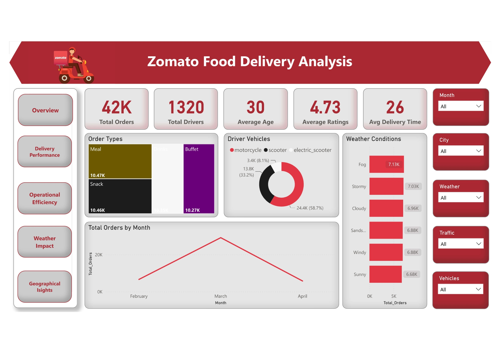
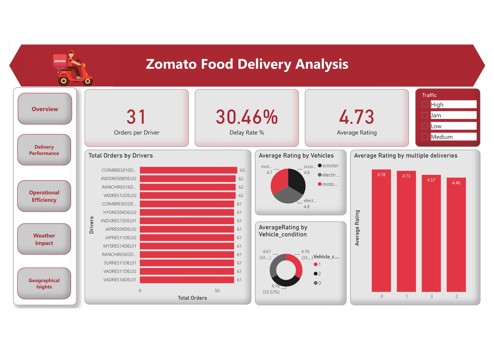
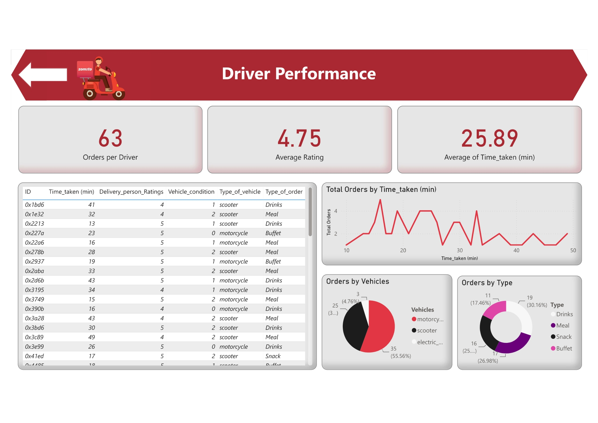
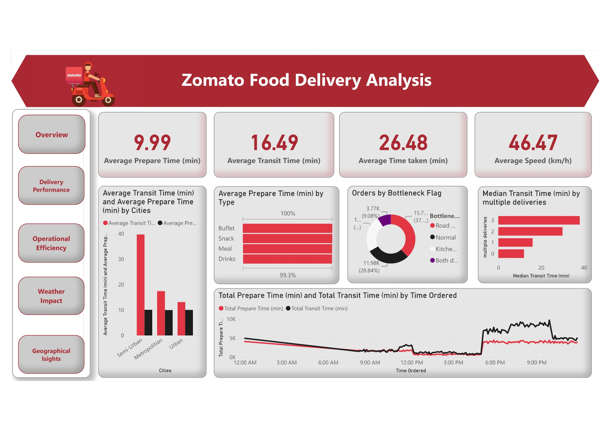
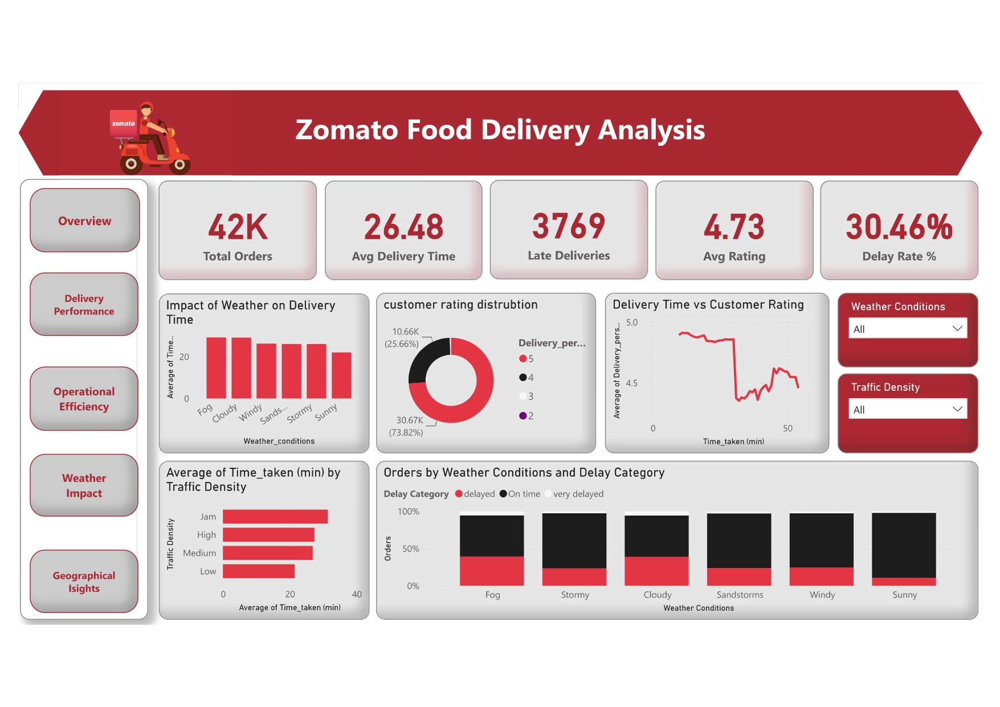
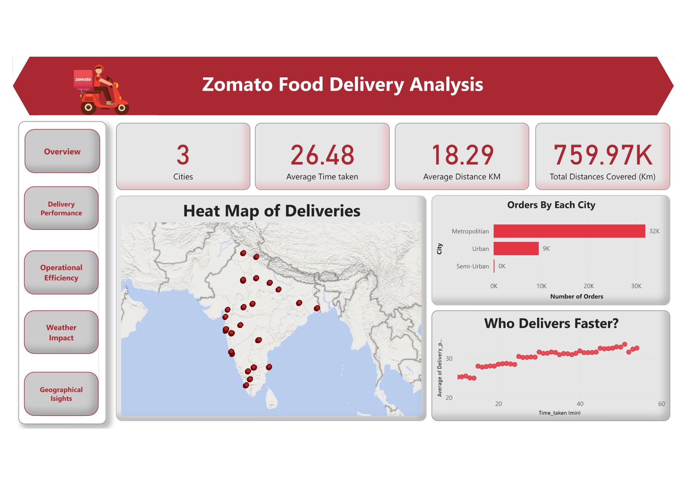

# 🍔 Zomato Food Delivery Performance & Analytics

An interactive **Power BI** dashboard that analyzes real-world food delivery data from Zomato to uncover patterns in delivery times, customer ratings, driver performance, and operational efficiency.

> **Final project – Data Analysis & Visualization**



---

## 📌 Table of Contents

- [Project Overview](#-project-overview)
- [Objectives & Research Questions](#-objectives--research-questions)
- [Dataset](#-dataset)
- [Data Preparation](#-data-preparation)
- [Dashboard Pages](#-dashboard-pages)
- [Key Findings](#-key-findings)
- [Recommendations](#-recommendations)
- [Tools & Technologies](#-tools--technologies)
- [Repository Structure](#-repository-structure)
- [How to Open the Dashboard](#-how-to-open-the-dashboard)
- [Team](#-team)
- [Limitations](#-limitations)

---

## 📖 Project Overview

Food delivery platforms generate huge volumes of data every day: order timestamps, delivery durations, driver details, customer feedback, and location data. This project takes a raw Zomato delivery dataset through a full pipeline — **collection → cleaning → feature engineering → EDA → interactive dashboard** — and turns it into actionable insights for delivery platforms and restaurant partners.

**Headline numbers from the dashboard:**

| Metric | Value |
|---|---|
| Total Orders | ~42K |
| Drivers | 1,320 |
| City types | 3 (Metropolitan, Urban, Semi-Urban) |
| Avg. Driver Rating | 4.73 |
| Avg. Delivery Time | 26.48 min |
| Delay Rate | 30.46% (3,769 late deliveries) |
| Avg. Distance per Order | 18.29 km |
| Total Distance Covered | ~760K km |

---

## 🎯 Objectives & Research Questions

The goal is to identify the key factors behind delivery delays, low satisfaction, and operational inefficiency, and present them in a dashboard that supports data-driven decisions.

1. What does delivery time look like across weather conditions, traffic density, and city types?
2. Which factors most strongly relate to customer ratings — delay, number of simultaneous deliveries, vehicle type?
3. Are there geographic or temporal patterns in delivery performance?
4. How do drivers, vehicle types, and order types compare in speed and satisfaction?
5. What operational bottlenecks exist (prep time vs. transit time), and how can they be improved?

---

## 🗂️ Dataset

- **Source:** Kaggle – Zomato Food Delivery dataset
- **File:** `Zomato_Dataset.csv`
- **Raw size:** 45,584 rows × 20 columns
- **Period covered:** February 11 – April 6, 2022 (peak volume in March)

| Column | Description |
|---|---|
| `ID` | Unique order ID |
| `Delivery_person_ID` | Unique driver ID (1,320 drivers) |
| `Delivery_person_Age` | Driver age |
| `Delivery_person_Ratings` | Driver's customer rating |
| `Restaurant_latitude / longitude` | Restaurant coordinates |
| `Delivery_location_latitude / longitude` | Delivery destination coordinates |
| `Order_Date` | Date of the order (DD-MM-YYYY) |
| `Time_Orderd` | Time the order was placed |
| `Time_Order_picked` | Time the order was picked up |
| `Weather_conditions` | Fog, Stormy, Cloudy, Sandstorms, Windy, Sunny |
| `Road_traffic_density` | Low, Medium, High, Jam |
| `Vehicle_condition` | Vehicle condition score (0–3) |
| `Type_of_order` | Snack, Meal, Drinks, Buffet |
| `Type_of_vehicle` | Motorcycle, Scooter, Electric scooter, Bicycle |
| `multiple_deliveries` | Number of additional orders the driver carried at the same time (0–3) |
| `Festival` | Whether the order was placed during a festival |
| `City` | City type: Metropolitian, Urban, Semi-Urban |
| `Time_taken (min)` | Total delivery time in minutes |

---

## 🧹 Data Preparation

Steps applied before building the dashboard:

- **Missing values** — the raw data had gaps in driver age (~1.9K), ratings (~1.9K), order time (~1.7K), city (~1.2K), multiple deliveries (~1K), weather (~600), traffic (~600), and festival (~230). Incomplete records were handled (removed or flagged), which brings the working dataset to ~42K orders.
- **Outliers / invalid values** — e.g. ratings above the 5-star maximum were treated as data errors.
- **Standardization** — date and time formats unified; city labels normalized.
- **Feature engineering**
  - `Prepare Time` – time between order placed and picked up (avg. 9.99 min)
  - `Transit Time` – time between pickup and delivery (avg. 16.49 min)
  - `Total Time` – prep + transit (avg. 26.48 min)
  - `Delay Category` – On time / Delayed / Very delayed (overall delay rate 30.46%)
  - `Bottleneck Flag` – Road, Kitchen, Both, or Normal
  - `Distance (km)` – derived from restaurant and delivery coordinates
  - `Speed (km/h)` – distance divided by transit time
  - Time-of-day and month attributes

---

## 📊 Dashboard Pages

The report contains **6 pages**, with a navigation menu on the left and slicers (Month, City, Weather, Traffic, Vehicles) for interactive filtering.

### 1️⃣ Overview


Performance snapshot with KPIs: **42K** orders, **1,320** drivers, average driver age **30**, average rating **4.73**, and average delivery time **26 min**.
Visuals: order types (Meal, Snack, Drinks, Buffet — roughly 10.3K–10.5K each), driver vehicles (58.7% motorcycle, 33.2% scooter, 8.1% electric scooter), orders by weather condition, and total orders by month (peak in March).

### 2️⃣ Delivery Performance



KPIs: **31** orders per driver, **30.46%** delay rate, **4.73** average rating, with a Traffic slicer.
Visuals: total orders by driver (top drivers at ~61–63 orders), average rating by vehicle type, average rating by vehicle condition, and average rating by number of multiple deliveries (4.78 with none, dropping to 4.46 with two).

### 3️⃣ Driver Performance *(Drill-through)*



A drill-through page reached from a specific driver. It shows that driver's orders (63 in the example), average rating (4.75), and average delivery time (25.89 min).
Visuals: a detailed order table (ID, time taken, rating, vehicle condition, vehicle type, order type), total orders by time taken, orders by vehicle, and orders by type. A back arrow returns to the main report.

### 4️⃣ Operational Efficiency



KPIs: average prepare time **9.99 min**, transit time **16.49 min**, total time **26.48 min**, and average speed **46.47 km/h**.
Visuals: transit vs. prepare time by city type, average prepare time by order type, orders by bottleneck flag, median transit time by number of multiple deliveries, and total prepare/transit time across the hours of the day (a clear jump from late afternoon into the evening).

### 5️⃣ Weather Impact



KPIs: 42K orders, 26.48 min average delivery time, **3,769** late deliveries, 4.73 average rating, 30.46% delay rate, with Weather and Traffic Density slicers.
Visuals: average delivery time by weather, customer rating distribution (~74% five-star), delivery time vs. customer rating, average time by traffic density, and orders by weather and delay category (On time / Delayed / Very delayed).

### 6️⃣ Geographical Insights



KPIs: 3 city types, 26.48 min average time, **18.29 km** average distance, **~760K km** total distance covered.
Visuals: heat map of deliveries across India, orders by city type (Metropolitan ~32K, Urban ~9K, Semi-Urban almost none), and a "Who Delivers Faster?" scatter plot against delivery time.

---

## 🔍 Key Findings

- **Delay rate is high:** 30.46% of orders (3,769) were delivered late.
- **Ratings are strong overall:** average 4.73, with ~74% of ratings at 5 stars — but ratings drop noticeably once delivery time goes past about 30 minutes.
- **Weather affects speed:** average delivery time is highest in Fog and Cloudy conditions (~29 min) and lowest when Sunny (~22 min). Fog and Cloudy also have the largest share of delayed orders.
- **Traffic matters:** delivery time rises steadily from Low traffic to Jam.
- **Simultaneous deliveries hurt satisfaction and speed:** ratings fall from 4.78 (no extra orders) to 4.46 (two extra orders), and median transit time rises with each extra order. Vehicle type matters much less (ratings stay between 4.7 and 4.8).
- **Semi-urban transit is far slower:** ~40 min average transit vs. ~17 min in metropolitan and ~13 min in urban areas.
- **Evening is the busiest bottleneck:** prepare and transit times jump from late afternoon onward.
- **Heavy geographic concentration:** metropolitan areas account for ~76% of orders; semi-urban areas are almost absent.
- **Motorcycles are the backbone of the fleet** (58.7% of orders).
- **Order types are balanced** (each of Snack, Meal, Drinks, and Buffet is roughly a quarter of orders).

---

## 💡 Recommendations

1. **Investigate delay causes** — especially in Fog and Cloudy conditions and during evening hours.
2. **Limit simultaneous deliveries** per driver to protect both ratings and delivery speed.
3. **Improve semi-urban logistics** — transit times there are far higher than in other city types.
4. **Expand beyond major cities** to balance demand and reduce over-reliance on metros.
5. **Invest in motorcycle maintenance and safety**, since they carry most orders.
6. **Target bottlenecks precisely** using the bottleneck flag (road vs. kitchen) so the right fix is applied.

---

## 🛠️ Tools & Technologies

| Category | Tools |
|---|---|
| BI & Dashboards | Microsoft Power BI (PBIP project format) |
| Data Cleaning & Modeling | Power Query, DAX, Microsoft Excel |
| Data Source | Kaggle (Zomato dataset), CSV |
| Version Control | Git / GitHub |
| Presentation | Microsoft PowerPoint |

---

## 📁 Repository Structure

```
├── DepiProject.pbip                         # Power BI project file
├── DepiProject.Report/                      # Report definition (pages & visuals)
├── DepiProject.SemanticModel/               # Data model, measures & queries
├── Zomato_Dataset.csv                       # Raw dataset
├── Food_Delivery_Proposal.pdf               # Project proposal
├── Zomato_Analysis_Presentation_EN.pptx     # Final presentation
├── Screenshots/                             # Dashboard page screenshots
└── README.md
```

> Adjust the names above to match your actual repo.

---

## ▶️ How to Open the Dashboard

1. Install the latest version of **Power BI Desktop**.
2. Enable the PBIP format: *File → Options and settings → Options → Preview features → Power BI Project (.pbip) save option*.
3. Clone this repository:
   ```bash
   git clone https://github.com/mhmdabualyazeed-lab/Zomato-Food-Delivery-Performance-Analytics.git
   ```
4. Open `DepiProject.pbip` in Power BI Desktop.
5. If prompted, update the CSV path in **Transform data → Data source settings** to point to your local copy of `Zomato_Dataset.csv`.

---

## 👥 Team

| Name | Role |
|---|---|
| Youssef Hussein Sophy | Data Collection & Report Writing |
| Mohanad Khaled Elsayed | Data Cleaning |
| Mohamed Ahmed Abu Alyazeed | Data Modeling |
| Mohamed Hassan Nour | Data Visualization |
| Omar Khalifa Kheder | Dashboard Organization & Presentation |

---

## ⚠️ Limitations

- The dataset covers only ~8 weeks (Feb–Apr 2022), so seasonal conclusions are limited.
- Semi-urban areas have very few orders, so conclusions about them are less statistically reliable.
- Ratings are per driver (not per order), so they can't be tied to individual delivery delays directly.
- Records with missing values were excluded, which may introduce some bias.
